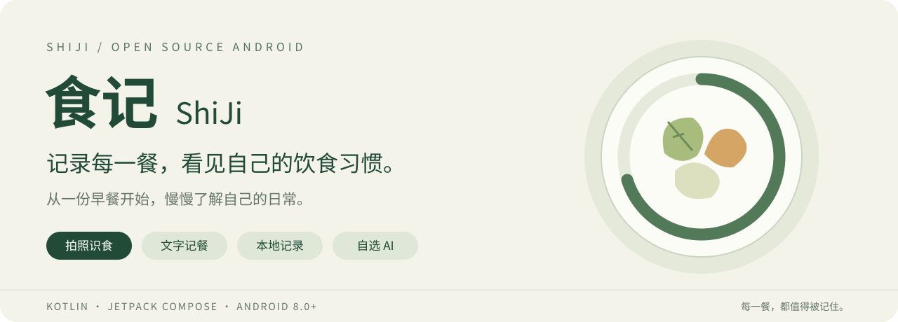
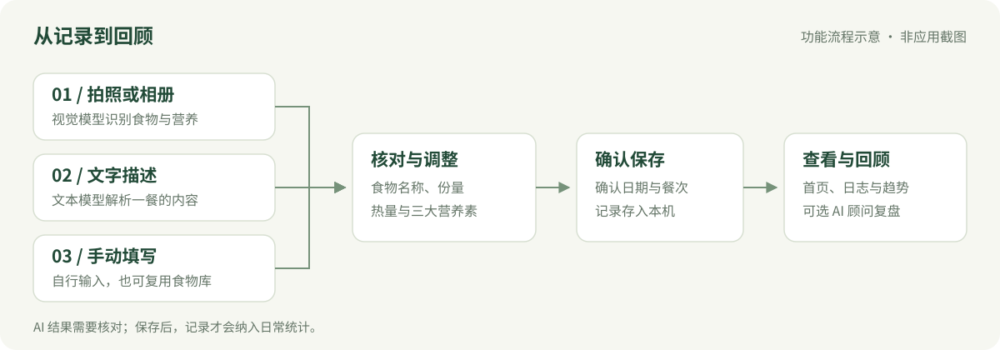
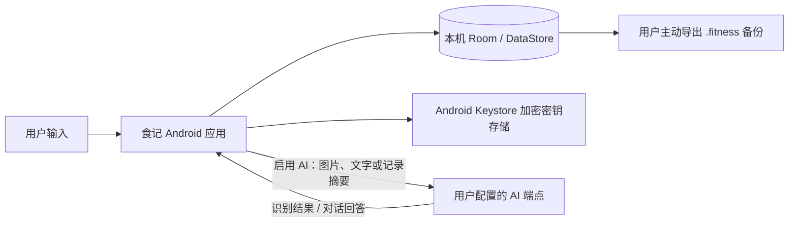

<p align="center">
  
</p>

<p align="center">
  <a href="https://github.com/MMHM02/Shiji/releases"></a>
  
  
  
  <a href="LICENSE"></a>
</p>

<p align="center"><b>拍张照片、写一句话，或者自己填。把每一餐，变成看得懂的日常记录。</b></p>

<p align="center">
  <a href="https://github.com/MMHM02/Shiji/releases">下载应用</a> ·
  <a href="#快速开始">快速开始</a> ·
  <a href="#使用指南">使用指南</a> ·
  <a href="#从源码运行">从源码运行</a> ·
  <a href="https://github.com/MMHM02/Shiji/issues">反馈问题</a>
</p>

## 食记是什么

**食记（ShiJi）**是一款开源 Android 饮食记录应用，将拍照识食、文字记餐、手动录入、营养统计、体重与饮水记录放在一起，帮助你了解「今天吃了什么」「距离自己的目标还有多少」「最近的饮食有什么变化」。

你可以只用它记录日常，也可以接入自己的大模型 API Key，让 AI 估算食物营养、结合已有记录回答饮食问题。文本和视觉模型可以分别选择，不必绑定同一家提供商。

饮食和健康记录保存在本机；使用在线 AI 时，相关图片、文字或饮食摘要会发送到你配置的 API 服务。**本地保存不等于 AI 全程离线**，具体数据流见下方[数据与隐私](#数据与隐私)。

适合希望养成记餐习惯、关注营养摄入、记录减脂或增肌过程的用户，也适合想了解 Compose、多模型接入和本地数据存储的 Android 开发者。

> 本文按当前源码版本 **0.2.4** 编写。下载包版本以 Releases 为准。AI 营养结果是估算值，请核对份量和食物信息；健康建议不能替代专业诊疗。

## 功能一览

| 功能 | 可以做什么 | 是否需要在线 AI |
| --- | --- | --- |
| 拍照识食 | 拍照或从相册选图，识别食物，核对结果后保存 | 需要视觉模型 |
| 文字记餐 | 用自然语言描述一餐，解析食物和营养 | AI 解析需要文本模型 |
| 手动记录 | 输入食物、份量、热量和三大营养素；可选 AI 估算 | 手动填写不需要 |
| 首页概览 | 查看热量圆环、营养摄入、饮水进度和当日餐食 | 不需要 |
| 饮食日志 | 按日期回看记录，通过日历定位，删除错误记录 | 不需要 |
| 数据看板 | 查看今日概览、近 7 天热量趋势和饮食提示 | 基础统计不需要 |
| AI 顾问 | 围绕自己的饮食、目标和体重进行流式对话 | 需要文本模型 |
| 个人食物库 | 添加、搜索常吃的食物，保存一份食物的份量和营养 | 不需要 |
| 体重与饮水 | 记录体重变化、查看趋势，登记饮水量 | 不需要 |
| 目标设定 | 设置热量、蛋白质、碳水、脂肪与饮水目标 | 不需要 |
| AI 模型配置 | 添加提供商、分别选择文本/视觉模型、测试连接、查看用量 | 测试与调用需要联网 |
| 数据备份 | 导出 `.fitness` 文件，导入已有备份 | 不需要 |
| 外观与桌面 | 切换明暗主题，使用热量桌面小组件 | 不需要 |

## 记录流程



*以上为功能流程示意图，不是应用截图。界面设计原型见 [design/](design/)，实际界面以运行中的应用为准。*

## 快速开始

### 1. 安装应用

打开 [GitHub Releases](https://github.com/MMHM02/Shiji/releases)，在目标版本的 **Assets** 中选择 APK 下载，传到 Android 手机后安装。最低支持 **Android 8.0（API 26）**。

如果该版本未提供 APK，可以按照[从源码运行](#从源码运行)自行构建。首次安装时，根据系统提示允许当前下载工具或文件管理器安装应用。

### 2. 设置自己的目标

首次打开后按引导进行设置，也可以稍后在「我的」中完善个人资料和目标。建议先填写适合自己的每日热量与营养目标，再开始记录，这样首页的进度更有参考价值。

### 3. 决定是否启用 AI

- **先体验基础功能**：直接使用手动记录、个人食物库、饮水、体重和统计，无需先配置 API Key。
- **希望用文字解析或 AI 顾问**：配置文本模型。
- **希望拍照识食**：另外确认视觉模型已配置，且该模型支持图片输入。

配置入口：**我的 → AI 模型配置**。完整步骤见下一节。

### 4. 记下第一餐

从首页选择记餐方式 → 输入内容 → 核对食物名称、份量和营养 → 确认餐次与日期 → 保存。随后回到首页或饮食日志查看结果。

## 配置 AI

### 文本和视觉模型有什么区别

| 模型用途 | 对应功能 | 如何选择 |
| --- | --- | --- |
| 文本模型 | 文字解析、手动录入中的 AI 估算、AI 顾问 | 选择已开通的文本对话模型 |
| 视觉模型 | 拍照识食、相册图片分析 | 必须选择支持图片输入的模型 |

可以使用同一提供商的两种模型，也可以组合不同提供商，例如一个用于日常文字对话，另一个用于食物图片识别。

### 配置步骤

1. 在所选 AI 服务商的开放平台申请 API Key，并确认可用额度和模型权限。
2. 进入 **我的 → AI 模型配置 → 添加提供商**，选择厂商或「自定义端点」。
3. 输入 API Key 和模型名称；自定义端点还需要填写 Base URL。
4. 点击 **测试连接**，成功后保存配置。
5. 分别进入 **文本模型**、**视觉模型** 标签页，选择要使用的提供商和模型，检查顶部「当前 AI 配置」。
6. 尝试一次文字解析；需要拍照功能时，再用食物图片验证视觉模型。

> 测试连接成功不代表视觉能力已经验证。拍照仍失败时，请检查视觉模型名称、图片输入能力和账号权限。

### 内置提供商

下表描述应用当前的预设能力，不代表厂商全部产品能力。模型名称可按账号实际支持的型号修改。

| 提供商 | 文本配置 | 视觉配置 | 内置 Base URL |
| --- | --- | --- | --- |
| DeepSeek | 支持 | 当前预设不提供 | `https://api.deepseek.com/v1` |
| Kimi / Moonshot | 支持 | 当前预设不提供 | `https://api.moonshot.cn/v1` |
| 通义千问 / Qwen | 支持 | 支持 | `https://dashscope.aliyuncs.com/compatible-mode/v1` |
| 智谱 GLM | 支持 | 支持 | `https://open.bigmodel.cn/api/paas/v4` |
| 自定义端点 | 按服务能力配置 | 按服务能力配置 | 用户填写 |

自定义端点使用 **OpenAI 兼容的 Chat Completions 协议**。填写基础地址即可，例如 `https://api.example.com/v1`，应用会追加 `/chat/completions`，不要重复填写这段路径。视觉服务还需要兼容图片消息格式。

API 调用费用与额度由所选服务商决定。应用中的调用次数和 Token 统计用于参考，部分 Token 数量为估算，账单以服务商后台为准。

## 使用指南

### 拍照识食：先识别，再确认

1. 从首页进入拍照入口，按提示授予相机权限；也可以选择相册图片。
2. 尽量拍清整份食物，避免遮挡，并确保已配置视觉模型。
3. 等待识别结果，逐项检查名称、份量、热量与营养素。
4. 修正不准确的信息，选择餐次和日期，再确认保存。

图片难以准确判断油量、酱料和隐藏食材。建议结合包装营养表、称重结果或实际份量做调整。

### 文字记餐：像描述一餐一样输入

例如：

> 午餐吃了一碗米饭，约 150 克；一份清炒西兰花，约 100 克；两个水煮蛋。

把**食物名称、份量和烹饪方式**写清楚，比只写「吃了一份午饭」更容易得到可用结果。AI 解析后同样需要确认再保存。未配置文本模型时，界面提供离线估算入口，结果不能视为在线模型分析。

### 手动记录与个人食物库

对于有营养标签的包装食品，或自己已经称重的食物，可以直接填写名称、份量、单位、热量、蛋白质、碳水和脂肪；需要时再使用 AI 估算。

常吃的早餐、饮品或固定搭配，可以通过记录确认页的「加入食物库」保存，也可以在个人食物库中添加。录入时让营养数值与填写的那一份食物对应，避免混淆「每 100 克」和「每份」。

### 查看日志、饮水和体重

- **首页**：查看选定日期的热量、营养摄入、饮水和餐食。
- **饮食日志**：使用日期切换或日历回看历史，有记录的日期会标记；错误记录可以删除后重新录入。
- **饮水记录**：登记饮水量，结合每日目标观察进度。
- **体重记录**：持续登记体重并查看趋势，比单次数字更有参考价值。
- **数据看板**：查看近 7 天热量变化；记录不足时可能显示空态提示。

### 向 AI 顾问提问

AI 顾问会结合当日餐食、热量与三大营养素、个人目标、最近体重及近一周热量摘要生成回答。可以尝试：

> 「根据今天已经记录的饮食，晚餐可以怎样搭配？」
>
> 「帮我复盘最近一周的饮食记录，指出值得注意的地方。」

建议的质量依赖于记录是否完整。没有记下的餐食不会自动进入分析；数据看板上的基础建议由本地规则生成，深入对话才会调用在线文本模型。

## 备份与恢复

在「我的」中进入数据导出/导入页面。备份使用 **`.fitness` 扩展名，内容为可阅读的 JSON**。

| 内容 | 当前备份情况 |
| --- | --- |
| 饮食记录 | 导出并可导入 |
| 体重、饮水记录 | 导出并可导入 |
| 部分个人目标与资料 | 导出并可导入 |
| 个人食物库 | 导出基础营养字段；当前未包含默认份量和单位 |
| AI 提供商信息 | 会导出元数据，当前导入逻辑不恢复它们 |
| API Key、食物照片 | 不包含 |

**导出：**确认导出后，应用将文件写入页面显示的备份目录。当前同一目录只保留一个 `.fitness` 文件，新导出会删除旧备份；需要保留多个版本时，请先把旧文件复制到其他位置。

**导入：**将待恢复的 `.fitness` 文件放入页面显示的备份目录，再进入导入流程确认。请只放入要恢复的那一份备份，避免读取到其他文件。

> **当前实现的两个注意点：**
>
> - 备份实际位于应用专属文件目录下的 `ShiJi/`，以页面显示的完整路径为准，不能按部分界面文案假定它一定在公共「下载」目录。新版本 Android 可能限制文件管理器访问 `Android/data`。卸载前请把备份复制到应用目录之外。
> - 虽然导入确认文案写着「覆盖」，当前代码对饮食和健康记录执行的是追加插入，重复导入可能产生重复记录；目标会更新。它不是完整设备迁移工具，新设备仍需重新配置 AI，食物库份量也应重新核对。

## 数据与隐私

食记采用本地存储与用户自选 AI 接口的组合，不需要额外部署食记后端。



| 数据 | 存储或传输方式 |
| --- | --- |
| 饮食、体重、饮水和目标 | 保存在本机数据库中 |
| 偏好与模型选择 | 保存在本机 DataStore 中 |
| API Key | 使用 Android Keystore 与 EncryptedSharedPreferences 在本机加密存储；请求时作为认证信息发送给配置的端点 |
| 食物照片与文字描述 | 使用 AI 识别时发送给对应模型服务 |
| AI 顾问上下文 | 对话时发送相关饮食、目标、体重摘要和消息内容 |
| 备份文件 | 用户主动导出到本机；其中包含个人饮食与健康数据 |

自定义端点可能是厂商、自部署服务或第三方中转，数据由该端点接收。应用当前允许 Android 系统备份，因此也不能将「本地存储」理解为禁止所有系统级备份。

应用声明网络访问、网络状态和相机权限；当前没有录音权限，也没有可用的语音记餐界面。

开发者可从 [AI 请求适配器](core/ai/src/main/java/com/shiji/core/ai/adapters/OpenAiCompatibleAdapter.kt)、[密钥存储](core/common/src/main/java/com/shiji/core/common/security/EncryptedKeyStore.kt)、[顾问上下文](app/src/main/java/com/shiji/app/domain/ai/AdvisorContextBuilder.kt) 和 [AndroidManifest](app/src/main/AndroidManifest.xml) 核对实现。

## 从源码运行

### 环境准备

| 项目 | 要求 / 当前配置 |
| --- | --- |
| Android Studio | 支持 AGP 8.7.3 的版本 |
| JDK | 17 |
| Android SDK | Platform 35，安装相应构建工具 |
| 运行设备 | Android 8.0+ 真机或模拟器 |
| Gradle | 仓库 Wrapper：8.11.1，无需单独安装 |

### 使用 Android Studio

```bash
git clone https://github.com/MMHM02/Shiji.git
cd Shiji
```

1. 用 Android Studio 打开仓库根目录。
2. 在 SDK Manager 中安装 Android SDK Platform 35，设置 Gradle JDK 为 17。
3. 让 IDE 生成 `local.properties`，或复制 `local.properties.template` 并填写自己的 `sdk.dir`。
4. 等待 Gradle Sync 完成，选择 `app` 和运行设备，点击 Run。
5. 应用启动后在「我的 → AI 模型配置」中填写 Key。**构建 APK 本身不需要 API Key。**

### 命令行构建

Windows PowerShell：

```powershell
.\gradlew.bat assembleDebug
```

macOS / Linux：

```bash
chmod +x gradlew
./gradlew assembleDebug
```

生成的 APK 位于：

```text
app/build/outputs/apk/debug/app-debug.apk
```

Debug 包名为 `com.shiji.app.debug`，Release 包名为 `com.shiji.app`，两者使用独立的应用数据目录。

<details>
<summary>开发检查与 Release 构建</summary>

仓库提供 ktlint、detekt、单元测试和 APK 构建工作流。本地可运行：

```powershell
.\gradlew.bat ktlintCheck
.\gradlew.bat detekt
.\gradlew.bat test
.\gradlew.bat assembleRelease
```

macOS / Linux 将 `.\gradlew.bat` 替换为 `./gradlew`。设备端测试需要连接真机或启动模拟器。

当前 Release 构建会在根目录查找 `shiji-release.jks`，并读取 `RELEASE_STORE_PASSWORD`、`RELEASE_KEY_ALIAS`、`RELEASE_KEY_PASSWORD` Gradle 属性；没有该密钥文件时回退到 debug 签名。正式分发前请配置自己的签名，并妥善保管签名文件与密码。

当前 CI 配置监听 `main` / `develop` 的 push 和面向 `main` 的 PR；其他分支推送不会自动触发该工作流。

</details>

## 技术栈与项目结构

| 层次 | 实现 |
| --- | --- |
| 界面 | Kotlin 2.1.0、Jetpack Compose、Material 3 |
| 状态与导航 | ViewModel、StateFlow、Coroutines、Navigation Compose |
| 依赖注入 | Hilt |
| 本地数据 | Room 2.7.0、DataStore |
| AI 网络调用 | OkHttp、Kotlinx Serialization、OpenAI 兼容接口、SSE 流式响应 |
| 图片 | CameraX、图片预处理、Coil 3 |
| 密钥存储 | Android Keystore、EncryptedSharedPreferences |
| 工程检查 | Gradle、ktlint、detekt、JUnit、GitHub Actions |

```text
Shiji/
├── app/                    # 应用入口、导航、界面、ViewModel、依赖注入与小组件
├── core/
│   ├── ai/                 # 提供商配置、请求适配、响应解析、提示词与用量统计
│   ├── camera/             # 图片预处理
│   ├── common/             # 密钥存储、权限与通用工具
│   ├── data/               # Room、DAO、实体、DataStore、备份序列化
│   └── voice/              # 预留模块，当前无语音录入功能
├── feature/                # diet / health / settings 功能模块骨架
├── design/                 # HTML/CSS 设计原型与品牌规范
├── docs/                   # 产品、架构、AI 方案、路线图与 README 配图
├── gradle/                 # Wrapper 与依赖版本目录
└── .github/workflows/      # 持续集成配置
```

当前主要页面实现在 `app` 模块中，`feature` 模块仍以骨架为主。查找页面逻辑时优先从 `app/src/main/java/com/shiji/app/ui/` 入手。

## 常见问题

<details>
<summary>没有 API Key，可以使用吗？</summary>

可以。手动记录、食物库、基础统计、体重与饮水记录不依赖在线 AI。拍照识别、在线文字解析和 AI 顾问需要相应模型配置。

</details>

<details>
<summary>文字对话正常，为什么拍照识别失败？</summary>

文本和视觉分别配置。确认视觉标签页已选择模型，模型支持图片输入，账号有权限且额度可用。DeepSeek 和 Kimi 在应用当前预设中只用于文本；也可配置支持视觉的自定义兼容端点。

</details>

<details>
<summary>连接失败、401、404 或限流应该检查什么？</summary>

先检查网络、Key、账号额度和模型名称。401 通常与认证有关；404 可检查模型是否存在，以及 Base URL 是否错误地包含了重复的 `/chat/completions`；限流时降低请求频率并查看服务商限制。自定义服务还需确认协议兼容。

</details>

<details>
<summary>识别热量不准确怎么办？</summary>

拍照无法直接测出重量和全部配料。请在确认页修正份量与营养值；有包装标签或称重数据时优先使用这些数据。常吃食物可以保存到食物库，减少反复估算带来的差异。

</details>

<details>
<summary>换手机会自动同步吗？</summary>

当前没有食记账号云同步。请参考备份说明迁移可导出的记录，照片和 API Key 不在备份中，AI 配置需要重新设置。当前导入有追加记录等限制，不建议重复导入同一个文件。

</details>

<details>
<summary>构建时 Gradle 下载失败怎么办？</summary>

检查网络、代理和 Android Studio 的 Gradle 设置。仓库 Wrapper 当前使用腾讯镜像；如果镜像不可用，可在 `gradle/wrapper/gradle-wrapper.properties` 中将 `distributionUrl` 换成相同版本的官方地址 `https://services.gradle.org/distributions/gradle-8.11.1-bin.zip`，不要同时随意升级 Gradle 与 AGP。

</details>

## 项目文档

以下文档包含需求分析和早期设计方案，部分内容属于规划，**已实现能力以当前源码和本 README 为准**。

| 文档 | 内容 |
| --- | --- |
| [需求分析](docs/01-requirements.md) | 使用场景、用户画像与功能需求 |
| [产品设计](docs/02-product-design.md) | 信息架构与交互设计 |
| [技术架构](docs/03-architecture.md) | 分层、技术选型与数据模型 |
| [AI 集成方案](docs/04-ai-integration.md) | 模型接入、提示词与视觉识别方案 |
| [功能实现方案](docs/05-feature-implementation.md) | 功能设计与实现思路 |
| [路线图](docs/06-roadmap.md) | 阶段规划与历史记录 |
| [UI 设计说明](docs/07-ui-design-brief.md) | 界面设计方向 |

## 参与贡献

欢迎通过 [Issues](https://github.com/MMHM02/Shiji/issues) 提交问题或建议，通过 Pull Request 改进代码和文档。

反馈问题时，请提供应用版本、Android 版本、复现步骤、预期结果与实际表现；AI 相关问题可补充提供商和模型名。截图与日志请移除 API Key 和个人健康信息。

提交代码前请尽量运行与改动相关的检查，并说明验证结果。文档改进、交互体验、模型兼容性和数据可靠性方面的贡献同样欢迎。

## 开源许可

本项目基于 [Apache License 2.0](LICENSE) 开源。使用、修改和分发时请遵守许可证，并保留适用的版权与许可声明。
